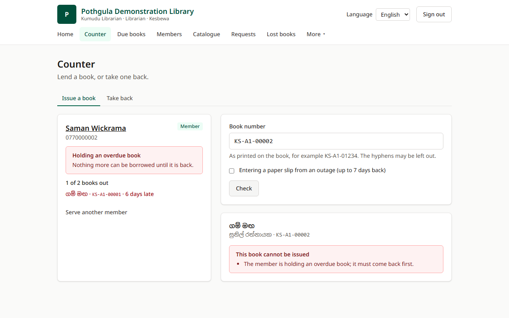
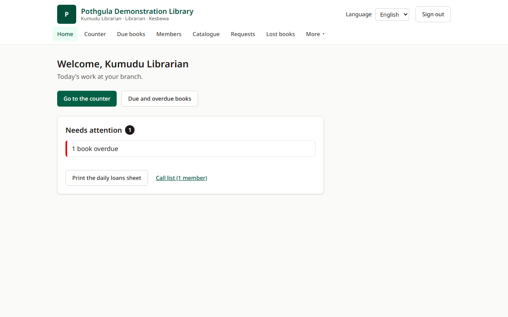
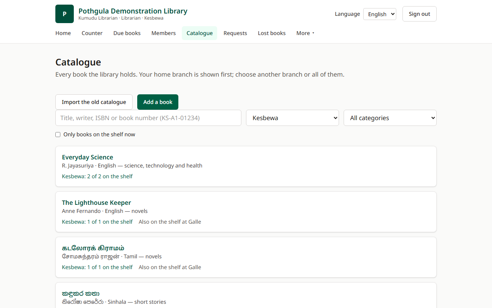
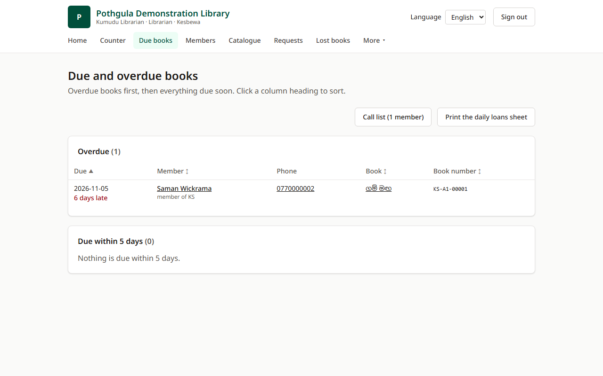
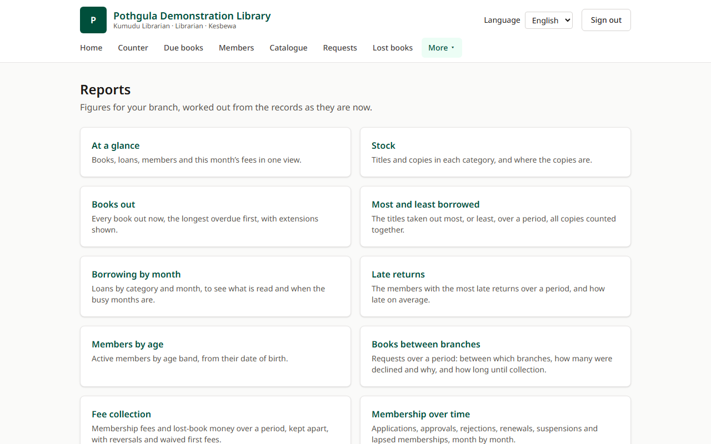
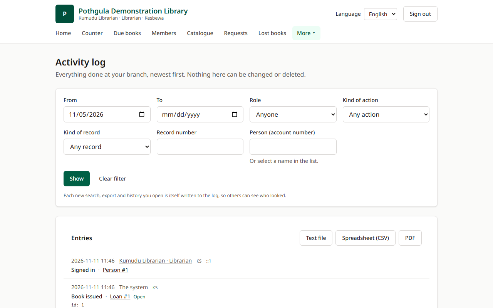
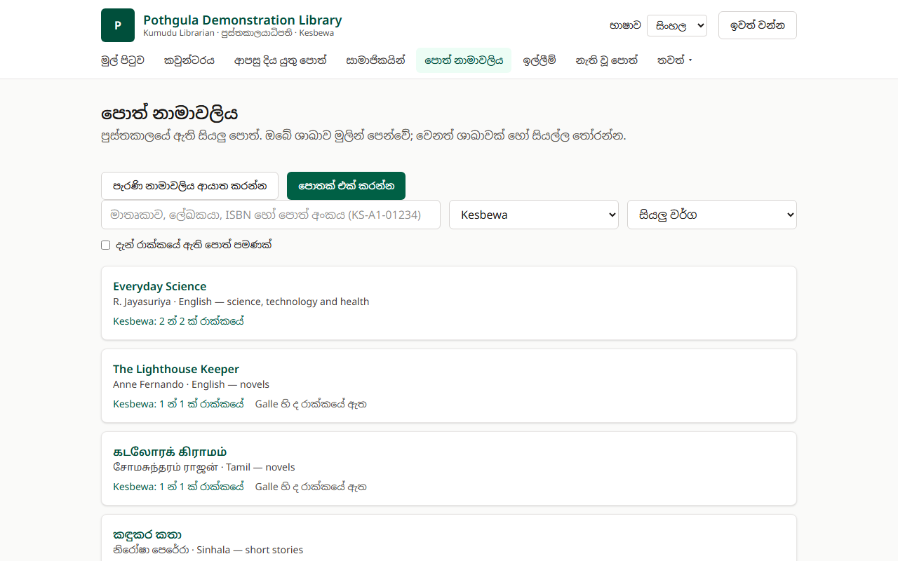
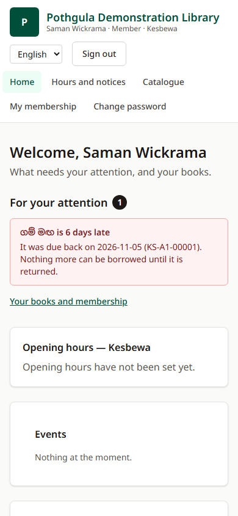

<div align="center">

# Pothgula

**A free, open-source library management system for small libraries with several branches.**

One shared catalogue, a lending counter, memberships and fees, books sent between branches, lost-book settlements, reports and an activity log that cannot be changed. Works in English and Sinhala.

[](https://github.com/Chathuranga97lj/pothgula/actions/workflows/ci.yml)
[](LICENSE)




</div>

> **Status: in development.** Phase 1 ("the counter works") is released as v0.1.0. Phase 2 ("the library runs itself": requests between branches, extensions, lost books, reports, opening hours and notices) is built and in review. See the [roadmap](#roadmap).

_Pothgula_ (පොත්ගුල) is the Sinhala word for a library, a "house of books".

## Why Pothgula

Many community and temple libraries still run on paper registers. Pothgula is built for them:

- **Nothing to pay for.** No SMS, email or WhatsApp gateway, no paid hosting tier, no font CDN. Everything, including fonts and images, is served by the app itself.
- **Nothing is lost.** Records are never deleted: they are withdrawn, voided, deactivated or anonymised. Every change is written to an append-only activity log in the same database transaction.
- **Rules the database keeps.** Book limits, availability and lateness are worked out from the records, not stored, and the important rules are enforced by PostgreSQL constraints and triggers as well as by the code.
- **Made for the counter.** Book numbers like `KS-A1-01234` can be typed without hyphens; paper slips written during a power cut can be entered later with their real date.
- **Runs on one small server.** Docker Compose with free automatic HTTPS (Caddy), nightly backups and a tested restore.

## Screenshots

|                                                                                  |                                                                                 |
| -------------------------------------------------------------------------------- | ------------------------------------------------------------------------------- |
|  |  |
| **Librarian's home**: today's work at the branch                                 | **Catalogue**: one title, many copies, availability per branch                  |
|                                |                                         |
| **Due books**: overdue lists and a call list (alerts are on screen only)         | **Reports**: stock, loans, members, fees; export as text, CSV or PDF            |
|   |              |
| **Activity log**: every change, sign-in and export; nothing can be edited        | **Sinhala**: every screen in English and Sinhala, with Tamil books alongside    |

<p align="center">
  <br>
  <b>On a phone</b>: a member sees their books, due dates, opening hours and notices.
</p>

All names, books and numbers in the screenshots are invented demonstration data. To take them again: `pnpm screenshots` (needs `pnpm db:up`).

## Features

**Lending**

- Issue and take back at the counter, with every reason a book cannot be lent shown at once (book limit, overdue book, expired membership, …).
- Two-week loans; one two-week extension per loan, requested by the member and approved by staff.
- Due and overdue lists, a daily loans sheet and a call list, printable as PDF.

**Catalogue**

- Title and copy model: each physical copy gets a permanent accession number (`branch-category-number`).
- Search by title, writer, ISBN or book number; filter by branch, category and what is on the shelf.
- Import an old catalogue from CSV, with probable duplicates found and decided before anything is written; print spine labels.

**Members**

- Members apply online and are approved in person, when identity is checked and the first annual fee is paid. Renewals, receipts and reversals.
- A member's own pages: their books, requests, payments and receipts, extension requests and notices.

**Several branches**

- Every copy and member has a home branch; librarians work in their own branch, super admins across all.
- Members can request a book from another branch: it travels there, is held, issued, and travels back, with transit slips.
- Opening hours and closures per branch; notices and events for one branch or all.

**Lost and damaged books**

- Declaring a book lost opens a settlement priced from the owning branch's tariff, paid in full or by a replacement copy.
- Limits while a settlement is open, and automatic suspension when its window passes.

**Records and reports**

- An append-only activity log, readable and exportable by staff (`.txt`, `.csv`, PDF), with old entries archived to checked files.
- Reports on stock, loans, popular titles, late returns, members by age, requests between branches, fee collection and missing books.

## Tech stack

| Piece     | Choice                                                               |
| --------- | -------------------------------------------------------------------- |
| Database  | PostgreSQL 17 (constraints, triggers, `pg_trgm`)                     |
| API       | Node 24 LTS, NestJS 12, Drizzle ORM, Zod 4                           |
| Web       | React 19, Vite 8, Tailwind CSS 4, react-i18next                      |
| Shared    | Zod schemas and rules in `packages/shared`, used by both API and web |
| Tests     | Vitest 5, Testcontainers, Playwright                                 |
| Packaging | pnpm 10 workspaces, Docker Compose, Caddy                            |

The reasons for each choice are in [`docs/tech-stack-decision.html`](docs/tech-stack-decision.html).

## Getting started (development)

You need **Node 24** (see `.node-version`), **pnpm 10** and **Docker**.

```sh
git clone https://github.com/Chathuranga97lj/pothgula.git
cd pothgula
pnpm install
pnpm build:shared      # the API and web app import the built shared package
pnpm db:up             # PostgreSQL 17 for development, on localhost:5433
pnpm --filter @pothgula/api db:migrate
pnpm --filter @pothgula/api db:seed   # invented demonstration data
pnpm dev               # API on :3000, web on http://localhost:5173
```

To sign in, create the first super admin. This is done on the server, never through the website:

```sh
pnpm --filter @pothgula/api create-super-admin --name "Your Name" --phone 07XXXXXXXX
```

It prints a temporary password that must be changed at the first sign-in. The sign-in name is the phone number. If every super admin is locked out, `pnpm --filter @pothgula/api reset-super-admin --phone 07XXXXXXXX` issues a new temporary password; both commands are written to the activity log.

The development database listens on **5433**, not 5432, so it does not collide with a PostgreSQL already installed. Set `POTHGULA_DB_PORT` to change it, and `DATABASE_URL` to point the API elsewhere.

### Checks

```sh
pnpm format:check && pnpm lint && pnpm typecheck && pnpm test && pnpm build
pnpm e2e    # Playwright browser tests on a throwaway database (needs pnpm db:up)
```

The API's database tests start their own PostgreSQL container with Testcontainers, so Docker must be running for `pnpm test`; `pnpm --filter @pothgula/api test:unit` runs only the tests that need no database. Before the first `pnpm e2e`, install the browser once: `pnpm --filter @pothgula/e2e exec playwright install chromium`.

CI runs all of this on every pull request, and also installs the production setup on a clean machine and rehearses a backup and restore.

## Installing for a library

[`docs/setup.md`](docs/setup.md) walks through a production install on one server:

```sh
cd infra && docker compose up -d --build
```

It covers the single settings file, free HTTPS, nightly backups kept for 30 days, a weekly copy to a library computer, and how to rehearse a restore.

## Repository layout

```
apps/api         NestJS API (one folder per area: circulation, requests, settlements, reports, …)
apps/web         React front end (builds to static files; translations in src/locales)
packages/shared  Zod schemas, accession numbers, dates and rules shared by both sides
infra/           Production compose file, Dockerfiles, Caddyfile, backup and restore scripts
e2e/             Playwright browser tests and the README screenshots
docs/            Requirements, design decisions, setup and translation guides
```

## Documentation

- [Requirements (SRS v3.1)](docs/requirements-v3.1.html): the scope, with every requirement ID ([PDF](docs/Pothgula-Requirements-v3.1.pdf))
- [Technology decision](docs/tech-stack-decision.html) and [architecture decision records](docs/adr)
- [Installation guide](docs/setup.md)
- [Translating Pothgula](docs/translating.md): reviewing Sinhala, adding Tamil or another language

## Roadmap

- [x] **Phase 1: the counter works** (v0.1.0): sign-in, roles, branches, catalogue, members and fees, issue and take back, due lists, activity log, CSV import, backups.
- [ ] **Phase 2: the library runs itself** (built, in review): requests between branches, extensions, lost-book settlements, reports, receipts, opening hours, notices and events.
- [ ] **Phase 3**: the year-end summary report and other later requests from the library.

## Contributing

Contributions are welcome, especially translations (a native Sinhala reading, or Tamil) and testing in real libraries. Please read [CONTRIBUTING.md](CONTRIBUTING.md) first: it explains the scope, the branch and commit conventions, and the rules that are easy to break (dates in Asia/Colombo, money in integer cents, nothing deleted, a log entry with every change, no paid services).

Please use only invented names and numbers in issues, tests and fixtures, never real member data.

## Licence

[MIT](LICENSE) © 2026 Chathuranga Jayawardhana
