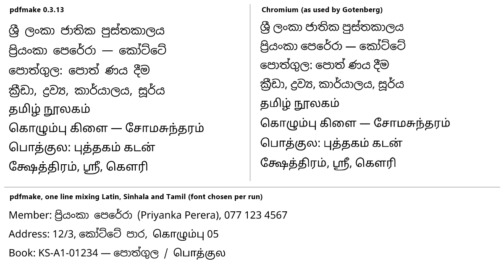

# ADR 0001 — PDF engine: pdfmake

- **Status:** accepted on merge of this ADR
- **Date:** 2026-11-06
- **Requirements:** FR-AUT-19 and FR-RPT-13 (single-member PDF, Phase 1); FR-LOG-08, FR-RPT-09, FR-MEM-07, FR-REQ-13, FR-RPT-16 (Phase 2); NFR-04 (Sinhala and Tamil in PDF exports); NFR-11 (no paid service); NFR-13 (self-hostable)

## Question

Pothgula has to produce PDFs itself, and NFR-04 requires Sinhala and Tamil to come out correctly in them. Both scripts need complex text shaping:

- Sinhala: *rakaransaya* (ප්‍ර), *yansaya* (ව්‍ය), *repaya* (ර්‍ය), and the *kombuva* drawn before the consonant (පෙ).
- Tamil: two-part vowel signs split around the consonant (கொ, கௌ), and ligatures such as ஸ்ரீ.

Many PDF libraries cannot shape these scripts at all and print broken text. The development plan named two candidates:

| | pdfmake (pdfkit + fontkit) | Gotenberg (headless Chromium in its own container) |
|---|---|---|
| Licence | MIT | MIT |
| Runs | inside the API process | a separate container; the API sends it HTML |
| Memory | a few MB per document | Chromium; several hundred MB resident |
| Layout | declarative document tree | HTML and CSS |

## What was tested

The same eight lines (four Sinhala, four Tamil) were rendered by pdfmake 0.3.13 and by Chromium (Edge headless, the same Blink/HarfBuzz text stack Gotenberg uses), with the same Noto Sans Sinhala and Noto Sans Tamil font files. Both PDFs were rasterised for comparison. A second pdfmake test put Latin, Sinhala and Tamil in one line, the way a member record will.

## Result

- **pdfmake shapes both scripts correctly.** The output matches Chromium glyph for glyph: rakaransaya, yansaya, repaya, kombuva placement, Tamil split vowels and the ஸ்ரீ ligature.
- **The difference is word spacing.** A space typed inside Sinhala text takes the Sinhala font's space, which is wider than the Latin one. This is cosmetic, and the run-splitting helper below avoids it.
- **pdfmake has no automatic font fallback.** Each run of text must name its font. A mixed line works once it is split into runs by Unicode block:
  - Sinhala is U+0D80–U+0DFF; Tamil is U+0B80–U+0BFF.
  - ZWJ/ZWNJ, digits and punctuation stay with the run they sit in.
  - About 25 lines of code, tested in the spike.

Gotenberg was not run in Docker. Its rendering is Chromium's, which the reference column shows. Choosing pdfmake means it is not needed.

## Decision

**Use pdfmake in the API for every PDF the system produces.**

- **No extra service.** One container less to install, update and back up (NFR-13), and no Chromium in memory. That matters on the 512 MB free demo instance and on a small library server.
- **Fonts:** static Noto Sans, Noto Sans Sinhala and Noto Sans Tamil TTF files (Regular and Bold, SIL OFL) are committed under `apps/api/assets/fonts/` with their licence. They are loaded from local disk only; `setUrlAccessPolicy(() => false)` blocks any remote fetch. Static files are used rather than the variable fonts from the spike, to keep the image small.
- **A shared `pdf` module** in the API owns the fonts, the run-splitting helper (`splitByScript`), and the branch logo and name header every PDF carries (FR-BRN-04). It is built with the first PDF (FR-AUT-19, milestone M4), with unit tests for the splitter and a rendering test that checks the shaped glyph output for the sample lines above.

## When to revisit

Switch the affected document to Gotenberg (HTML to PDF) if:

- a document needs layout that pdfmake's document tree handles badly (long flowing reports with complex tables are the likely candidate: the year-end summary, FR-RPT-12, Phase 3); or
- a Sinhala or Tamil shaping defect turns up in real data that fontkit does not handle.

The `pdf` module is the only place that would change.
